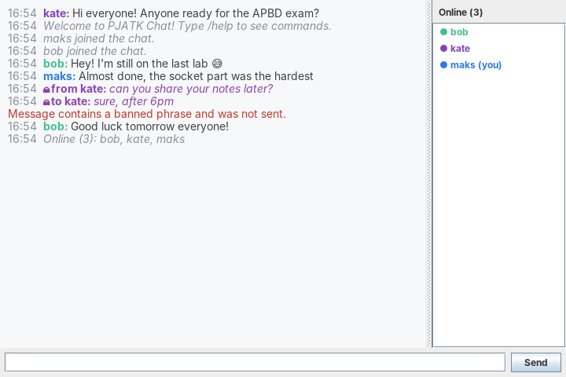

# Chat Application

A real-time multi-user chat written in Java: a socket server that handles each client on its own thread, and a Swing desktop client.



## Features

- **Public chat** with timestamps and a stable colour for every user
- **Private messages:** `/to <user> <message>`, or double-click a name in the user list
- **Online users panel**, updated live when someone joins or leaves
- **Message history:** new users receive the last 20 public messages
- **Exclude mode:** `/exclude anna,bob <message>` sends to everyone except the listed users
- **Banned phrases** from the server config, checked case-insensitively in every kind of message
- **Name validation:** a taken or invalid name can be changed without reconnecting
- **Commands:** `/help`, `/users`, `/banned`, `/quit`

## Architecture

```
src/chat/
├── common/Protocol.java        # text protocol shared by server and client
├── server/
│   ├── ChatServer.java         # accepts connections, keeps users & history, broadcasts
│   ├── ClientHandler.java      # one thread per user: login, messages, commands
│   └── ServerConfig.java       # port, server name, banned phrases
└── client/ChatClient.java      # Swing GUI
test/chat/server/ChatServerTest.java   # integration tests over real sockets
```

Client and server talk over TCP using a simple line protocol (`TYPE|field|...`), for example:

```
client → server   LOGIN|maks
server → client   LOGIN_OK|PJATK Chat
server → client   MSG|16:54|kate|Hi everyone!
server → client   PM|16:54|kate|maks|can you share your notes later?
server → client   USERS|bob,kate,maks
```

Users are kept in a `ConcurrentHashMap`, so joining, leaving and broadcasting are safe from many threads at once.

## Configuration

`server_config`: port on the first line, server name on the second, then banned phrases (one per line).

```
12345
MyServer
prohibited
```

## Running

Requires JDK 17+.

**IntelliJ IDEA:** open the folder (Maven project), run `chat.server.ChatServer`, then run `chat.client.ChatClient` once per user. To start several clients, enable *Allow multiple instances* in the run configuration.

**Command line:**

```bash
mvn compile
java -cp target/classes chat.server.ChatServer            # terminal 1
java -cp target/classes chat.client.ChatClient            # terminal 2, 3, ...
```

**Tests:**

```bash
mvn test
```
